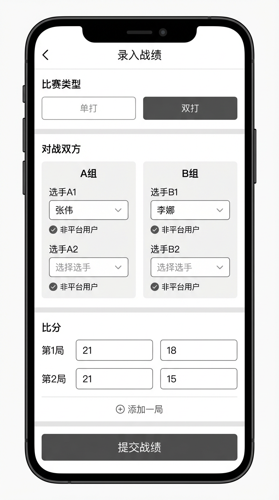

# 羽约 (SmashMate) 产品需求文档

**版本**: v1.0
**最后更新**: 2026-04-01
**作者**: PM Agent & 用户共创

| 版本 | 日期 | 修改人 | 修改内容 |
|------|------|--------|----------|
| v1.0 | 2026-04-01 | PM Agent | 初始版本（一期） |
| v1.1 | 2026-04-13 | PM Agent | 新增教练审核(GA) + 学员班(GB) + 固定私教学员(GC) — 原 prd-coaching-v2.md 文件已并入此版本 |
| v1.2 | 2026-04-15 | PM Agent | 统一学员管理 + 统一私教模型重构（详见 docs/redesign/coach-student-unified.md），合并 GC 为统一学员库描述；新增退课禁止统一规则 |

---

## 1. 项目概述

### 1.1 背景

羽毛球爱好者目前主要通过微信群组织约球和找教练，存在以下痛点：
- 信息分散在多个群聊中，难以检索和筛选合适的活动
- 无法记录和追踪比赛战绩，缺乏成就感和成长可视化
- 找教练依赖熟人推荐，信息不透明，缺少评价参考
- 活动变更（取消、改时间）时通知不及时，容易遗漏

### 1.2 目标用户

| 用户类型 | 特征描述 |
|----------|---------|
| 普通球友 | 一二线城市的羽毛球业余爱好者，有定期约球打球的需求 |
| 竞技选手 | 有竞技提升需求，关注战绩记录和教练指导 |
| 教练 | 具备羽毛球教学能力，希望通过平台招收学员、管理课程 |

**地域范围**：一二线城市
**推广策略**：先服务单个社区/球馆圈子，验证后向外扩展

### 1.3 核心价值

一站式解决羽毛球爱好者约球、找教练、记录战绩的需求，替代微信群的碎片化组织方式。

### 1.4 竞品/现状分析

| 维度 | 微信群（现状） | 本产品 |
|------|--------------|--------|
| 活动发布 | 群内文字发布，易被刷屏淹没 | 结构化发布，按时间/距离/空余筛选 |
| 信息检索 | 聊天记录中翻找，无法筛选 | 列表化展示，支持多维度筛选 |
| 找教练 | 依赖熟人推荐，信息不透明 | 教练入驻平台，有评价评分体系 |
| 战绩记录 | 无 | 支持多局比分记录，个人战绩汇总 |
| 活动变更通知 | 手动@群成员，易遗漏 | 系统自动通知所有参与者 |

---

## 2. 用户旅程

### 2.1 约球场景——普通球友发起约球

**角色**: 普通球友（已注册）
**目标**: 组织一场羽毛球活动
**前置条件**: 用户已登录

**操作路径**:
1. 用户进入首页 → 点击"发起约球"
2. 填写活动信息：选择球馆（输入关键词自动匹配附近球馆）、设定开始时间和结束时间、限定人数 → 提交发布
3. 活动出现在约球列表中 → 其他用户可见
4. 有人加入时，发起人收到通知
5. 活动结束后，发起人或参与者可录入战绩

**异常路径**:
- 若发起人需要修改活动信息：编辑活动 → 系统自动通知所有已加入的参与者
- 若发起人取消活动：确认取消 → 系统自动通知所有参与者 → 活动标记为已取消

### 2.2 约球场景——球友加入活动

**角色**: 普通球友（已注册）
**目标**: 找到合适的活动并加入
**前置条件**: 用户已登录

**操作路径**:
1. 用户进入首页 → 浏览约球活动列表
2. 通过筛选条件（时间、距离、是否有空余）过滤活动
3. 点击某个活动 → 查看详情（球馆、时间、已报名人数/限定人数、发起人）
4. 点击"加入" → 加入成功，收到确认通知
5. 活动结束后可录入战绩

**异常路径**:
- 若活动人数已满：显示"已满"状态，"加入"按钮不可点击
- 若活动已被取消：详情页显示"已取消"，无法加入

### 2.3 约教练场景——报名团课

**角色**: 普通球友
**目标**: 找到教练并报名团课
**前置条件**: 用户已登录

**操作路径**:
1. 用户进入"找教练"页面 → 浏览教练列表
2. 点击教练头像/名字 → 进入教练主页（简介、擅长方向、评分、历史学员数、课程列表）
3. 在课程列表中选择一个团课 → 查看团课详情（时间、地点、已报名/限定人数、费用说明）
4. 点击"报名" → 报名成功，收到确认通知
5. 课程结束后可评价教练，可录入战绩

**异常路径**:
- 若团课已满：显示"已满"，"报名"按钮不可点击

### 2.4 约教练场景——预约私教课

**角色**: 普通球友
**目标**: 预约教练的私教课
**前置条件**: 用户已登录

**操作路径**:
1. 用户进入教练主页 → 查看教练的私教空闲时间表（含可选球馆和费用说明）
2. 选择一个空闲时间段 → 若教练设置了多个可选球馆，选择其中一个作为上课地点 → 点击"预约"
3. 预约成功 → 用户和教练都收到通知
4. 课程结束后可评价教练，可录入战绩

**异常路径**:
- 若该时间段已被其他人预约：显示"已约"，不可选择

### 2.5 教练场景——发布课程

**角色**: 教练
**目标**: 发布团课或设置私教空闲时间
**前置条件**: 用户已登录，且已开启教练角色

**操作路径**:
1. 教练进入"我的课程"管理页面
2. 发布团课：填写课程名称、开始时间、结束时间、球馆、限定人数、费用说明 → 发布
3. 设置私教时间：在日历上勾选可用时间段、选择可用球馆（可多选或不选表示不限）、填写费用说明 → 保存
4. 有学员报名/预约时收到通知

### 2.6 战绩录入场景

**角色**: 活动发起人或参与者
**目标**: 记录一场比赛的战绩
**前置条件**: 用户是某次约球活动/团课/私教课的参与者

**操作路径**:
1. 进入某次活动详情页 → 点击"录入战绩"
2. 选择比赛类型：单打（1v1）或双打（2v2）
3. 选择或输入对战双方/两组（平台用户从参与者中选择；非平台用户输入昵称）
4. 输入每局比分（支持多局，如 21:18, 21:15）
5. 提交 → 战绩记录在相关平台用户的个人主页可见

**补充操作**:
- 活动详情页的战绩列表中，录入者可删除自己录入的战绩记录

---

## 3. 功能需求

### 3.1 用户管理（FA）

**描述**: 用户注册、登录、个人信息管理、角色管理。

**功能点**:
- [ ] FA-1: 用户注册（手机号+验证码注册，注册时可勾选是否为教练角色）
- [ ] FA-2: 用户登录
- [ ] FA-3: 个人资料编辑（头像、昵称、简介）
- [ ] FA-4: 教练角色开启（登录后可在设置中开启）
- [ ] FA-5: 个人主页（展示基本信息、历史战绩汇总——胜率、总场次）

**业务规则**:
1. 注册方式为手机号+短信验证码，不设密码
2. 手机号格式校验：中国大陆手机号（11 位，1 开头）
3. 同一手机号不可重复注册
4. 短信验证码为 6 位数字，有效期 5 分钟
5. 同一手机号 60 秒内不可重复发送验证码
6. 验证码输入错误超过 5 次后，该手机号锁定 30 分钟
7. 登录方式同为手机号+短信验证码（与注册方式一致）
8. 登录成功后保持登录态 7 天，过期后需重新登录
9. 昵称不可为空，长度限制 2-20 个字符
10. 注册时勾选教练角色后，自动拥有教练功能权限
11. 未在注册时勾选教练的用户，登录后可在"设置"中开启教练角色
12. 一个账号同时具备普通用户和教练两种身份，不需要切换账号

**验收标准**:
1. [ ] 输入手机号并获取验证码，输入正确验证码后注册成功
2. [ ] 60 秒内重复点击"获取验证码"提示"请稍后再试"
3. [ ] 验证码过期（5 分钟后）使用提示"验证码已过期"
4. [ ] 验证码错误超过 5 次后提示"操作过于频繁，请 30 分钟后再试"
5. [ ] 已注册手机号再次注册提示"该手机号已注册"
6. [ ] 登录成功后 7 天内再次打开无需重新登录
7. [ ] 注册时勾选"我是教练"后，登录即可发布团课和私教课
8. [ ] 非教练用户在设置中开启教练角色后，立即获得发布课程的能力
9. [ ] 个人主页正确展示历史战绩汇总（胜场/负场/平局/总场次/胜率）

### 3.2 约球（FB）

**描述**: 用户发起约球活动，其他用户浏览并加入。

**功能点**:
- [ ] FB-1: 发起约球活动（选择球馆、开始时间、结束时间、限定人数）
- [ ] FB-2: 约球活动列表（支持筛选：时间、距离、是否有空余）
- [ ] FB-3: 活动详情页
- [ ] FB-4: 加入活动
- [ ] FB-5: 退出活动
- [ ] FB-6: 修改活动信息（仅发起人）
- [ ] FB-7: 取消活动（仅发起人）
- [ ] FB-8: 活动状态自动流转

**业务规则**:
1. 发起活动时必填：球馆、开始时间、限定人数（最少 2 人，最多 50 人）
2. 球馆通过输入关键词自动匹配系统中已有的球馆，不支持自由填写
3. 活动开始时间必须晚于当前时间
4. 活动状态：报名中 → 已满员 → 进行中 → 已结束 / 已取消
5. 人数达到上限后状态自动变为"已满员"，有人退出后回到"报名中"
6. 发起活动时必须设定结束时间，结束时间必须晚于开始时间
7. 活动开始时间到达后状态自动变为"进行中"，结束时间到达后变为"已结束"
8. 发起人修改活动信息后，系统通知所有已加入的参与者
9. 发起人取消活动后，系统通知所有参与者，活动标记为"已取消"
10. 已取消的活动不可恢复
11. 发起人自动算作活动的第一个参与者
12. 已开始或已结束的活动不可修改、不可加入、不可退出
13. 发起人不可退出自己发起的活动（如需取消整个活动请使用"取消活动"功能）
14. 参与者退出活动后，系统通知发起人
15. 参与者在活动开始前均可退出活动
16. 活动列表"按距离排序"依赖用户定位授权；定位获取时机为用户首次使用距离相关功能时触发浏览器定位请求
17. 若用户拒绝定位授权，"按距离排序"不可用，默认按时间排序；距离筛选项隐藏
18. 筛选交互定义：时间筛选支持"今天/明天/本周/自定义日期"快捷选项；距离筛选支持选择范围（3km/5km/10km/不限）；空余筛选为开关型，开启后仅显示有空位的活动
19. 距离计算基准为用户实时定位坐标，拒绝定位时不显示活动的距离信息

**验收标准**:
1. [ ] 用户填写球馆、时间、人数后可成功发起活动
2. [ ] 活动列表支持按时间排序；授权定位后支持按距离排序，拒绝定位时距离排序不可用
3. [ ] 点击"加入"后参与者人数 +1，加入者收到确认通知
4. [ ] 人数满员后"加入"按钮不可点击，显示"已满员"
5. [ ] 有人退出满员活动后，状态恢复为"报名中"
6. [ ] 发起人修改活动后，所有参与者收到变更通知
7. [ ] 发起人取消活动后，所有参与者收到取消通知
8. [ ] 发起人无法退出自己发起的活动
9. [ ] 参与者退出活动后，发起人收到通知，参与者人数 -1
10. [ ] 已开始或已结束的活动无法退出
11. [ ] 时间筛选支持"今天/明天/本周/自定义日期"快捷选项
12. [ ] 距离筛选支持选择范围（3km/5km/10km/不限），拒绝定位时该筛选项隐藏
13. [ ] 空余筛选为开关型，开启后仅显示有空位的活动
14. [ ] 拒绝定位的用户不显示活动距离信息，默认按时间排序

### 3.3 教练管理（FC）

**描述**: 教练入驻平台，管理个人主页，发布团课和私教课。

**功能点**:
- [ ] FC-1: 教练资料编辑（简介、擅长方向标签选择）
- [ ] FC-2: 教练主页展示（简介、擅长方向、评分、历史学员数、课程列表）
- [ ] FC-3: 发布团课（课程名称、开始时间、结束时间、球馆、限定人数、费用说明）
- [ ] FC-4: 设置私教空闲时间（日历选择可用时间段、可选球馆、费用说明）
- [ ] FC-5: 教练列表页（供普通用户浏览）
- [ ] FC-6: 团课管理（修改、取消）
- [ ] FC-7: 私教预约管理（查看、取消）
- [ ] FC-8: 学员报名团课
- [ ] FC-9: 学员预约私教课
- [ ] FC-10: 学员取消团课报名
- [ ] FC-11: 学员取消私教预约

**业务规则**:
1. 只有教练角色的用户可以发布团课和设置私教时间
2. 团课必填：课程名称（最长 50 字符）、开始时间、结束时间、球馆、限定人数（最少 2 人，最多 30 人）
3. 团课结束时间必须晚于开始时间，开始时间必须晚于当前时间
4. 费用说明为文本描述字段，选填，一期不涉及在线支付
5. 私教时间段最小粒度为 1 小时
6. 同一时间段不可重复设置私教空闲
7. 教练设置私教课时可选择上课球馆（可多选，也可不选表示不限地点）；球馆从系统已有球馆中选择
8. 教练设置私教课时可填写费用说明（文本描述，选填，一期不涉及在线支付）
9. 学员预约私教课时，若教练设置了多个可选球馆，学员须从中选择一个作为上课地点
10. 团课状态流转：报名中 → 已满员 → 进行中 → 已结束 / 已取消
11. 团课开始时间到达后状态自动变为"进行中"，结束时间到达后变为"已结束"
12. 团课人数达到上限后状态自动变为"已满员"，有人取消报名后回到"报名中"
13. 私教课状态流转：待上课 → 进行中 → 已结束 / 已取消；未被预约的开放时段过期后自动标记为"已过期"，30 天后从数据库物理清除
14. 私教课开始时间到达后状态自动变为"进行中"，结束时间（开始时间 + 时间段时长）到达后变为"已结束"
15. 仅状态为"已结束"的团课/私教课可录入战绩和评价教练
16. 教练可修改团课信息（课程名称、时间、球馆、人数、费用说明均可修改），修改后系统通知所有已报名学员
17. 已开始或已结束的团课不可修改
18. 教练取消团课时，系统通知所有已报名学员
19. 教练取消私教预约时，系统通知对应学员
20. **退课/取消禁止规则**：所有课程（团课、私教、学员班课）一旦进入"进行中"或"已结束"状态，学员退课和教练取消均被拒绝（错误码 `COACHING_ALREADY_STARTED`），统一规则；前端按钮在该状态下应隐藏或置灰
21. 教练评分 = 所有评价的平均分（1-5 分）；无评价时不显示评分，显示"暂无评价"
22. 历史学员数 = 该教练所有团课和私教课的不重复参与人数
23. 教练列表默认按评分排序，支持按擅长方向筛选；擅长方向为预定义标签（单打、双打、步法、体能、战术），教练编辑资料时从中选择
24. 学员报名团课：团课未满员且未开始时可报名，报名后通知教练
25. 团课人数达到上限后不可报名，显示"已满员"
26. 学员预约私教：选择教练发布的空闲时间段，预约后该时间段变为"已约"，通知教练；若教练设置了可选球馆，学员须选择一个上课地点；并发预约通过乐观锁仅一人成功
27. 学员取消团课报名：团课开始前可取消，取消后通知教练，报名人数 -1
28. 学员取消私教预约：私教课开始前可取消，取消后通知教练；不再"释放为可预约"，原 slot 直接进入 cancelled 终态
29. 已开始或已结束的团课/私教课不可报名、不可取消（统一规则，详见规则 20）
30. **统一私教模型**：教练设置的"私教时段"、学员预约的"私教课"、教练直接为固定学员安排的"私教课"在数据层面是同一种实体。前端按需展示三种语义：未被预约的时段、学员预约的课、教练排的课

**验收标准**:
1. [ ] 教练可成功发布团课，团课出现在教练主页和课程列表中
2. [ ] 教练可在日历上设置空闲时间段，学员可见并可预约
3. [ ] 学员报名团课后，教练收到通知，团课已报名人数 +1
4. [ ] 团课满员后"报名"按钮不可点击，显示"已满员"
5. [ ] 学员预约私教后，该时间段变为"已约"，不可被其他人选择
6. [ ] 教练设置私教课时可选择多个球馆或不选（不限地点），可填写费用说明
7. [ ] 学员预约私教时，若教练设置了可选球馆，须从中选择一个上课地点
8. [ ] 学员取消团课报名后，教练收到通知，报名人数 -1
9. [ ] 学员取消私教预约后，教练收到通知，时间段恢复为"可预约"
10. [ ] 已开始的团课/私教课无法取消报名
11. [ ] 教练取消团课后，所有已报名学员收到通知
12. [ ] 教练主页正确展示评分（所有评价的平均分）和历史学员数；无评价时显示"暂无评价"
13. [ ] 教练修改团课信息后，所有已报名学员收到变更通知
14. [ ] 已开始或已结束的团课不可修改
15. [ ] 团课状态正确自动流转（报名中→已满员→进行中→已结束）
16. [ ] 私教课状态正确自动流转（待上课→进行中→已结束）
17. [ ] 仅已结束的课程可录入战绩和评价教练
18. [ ] 课程进入"进行中"或"已结束"后退课/取消按钮被拒绝（统一规则，跨团课/私教/学员班课）
19. [ ] 未被预约的私教时段过期后自动标记"已过期"，30 天后从数据库清除

### 3.3.1 教练审核（GA）

**描述**: 用户申请成为教练时，需上传证书/奖状由管理员审核通过后才能使用教练功能。一期已存在的教练自动保留资格。

**功能点**:
- [ ] GA-1: 用户提交教练申请（上传证书/奖状 + 简要说明）
- [ ] GA-2: 用户查询自己的申请状态（pending / approved / rejected）
- [ ] GA-3: 管理员审核列表（按状态筛选）
- [ ] GA-4: 管理员审核详情 + 通过/拒绝操作（拒绝必须填原因）
- [ ] GA-5: 审核通过后用户自动获得教练角色 + 收到通知；拒绝后用户收到带原因的通知，可重新提交

**业务规则**:
1. 一期数据库中 isCoach=true 的用户自动视为已通过审核，无需提交申请
2. 申请必填：1-5 张证书/奖状图片 URL；可选：简要说明（最多 200 字符）
3. 同一用户同一时刻只能有一个 pending 申请
4. 审核通过后系统将 user.isCoach 设为 true，用户立即获得全部教练能力
5. 管理员审核时通过无需理由，拒绝必须填理由（≥5 字符）
6. 通过/拒绝后系统自动给申请人发送站内通知

**验收标准**:
1. [ ] 用户提交申请后状态为 pending，可在"我的申请"看到
2. [ ] 已有 pending 申请时再次提交返回 409
3. [ ] 管理员可在后台看到所有申请并按状态筛选
4. [ ] 通过后申请人立即可发布团课、设置私教时段、创建学员班
5. [ ] 拒绝后通知中包含拒绝原因，用户可再次提交

### 3.3.2 学员班（GB）

**描述**: 教练可创建学员班并管理固定学员；按班级排课、记录训练内容和笔记。

**功能点**:
- [ ] GB-1: 创建/编辑/删除学员班（名称 2-30 字符）
- [ ] GB-2: 添加/移除班级成员
- [ ] GB-3: 班级排课（日期、时间、球馆、训练内容）
- [ ] GB-4: 编辑/取消未开始的课程
- [ ] GB-5: 录入课程训练内容（任何状态可改）+ 课程笔记（追加，仅教练可见）
- [ ] GB-6: 课程开始/结束时间到达后自动状态流转
- [ ] GB-7: 录入班内学员战绩（参与者限定为本班学员）

**业务规则**:
1. 仅 isCoach=true 的用户可创建学员班
2. 添加学员只能添加已注册用户（通过手机号或昵称搜索）；同一用户不可重复添加到同一班
3. 添加/移除成员后该学员收到通知
4. 创建课程必填：开始时间、结束时间、球馆；时间需在未来；通知班内全员
5. 已开始或已结束的课程不可编辑/取消（与团课/私教统一）
6. 课程开始后参与的全部学员自动写入"我的学员"统一库（source='class-lesson'）
7. 训练内容可任意时刻修改；课程笔记每次新增追加，单条 1-500 字符；笔记仅教练可见
8. 班级删除会级联删除该班的课程、成员关系、班级笔记，但战绩不删

**验收标准**:
1. [ ] 教练能创建班级并添加/移除成员，被操作的学员收到通知
2. [ ] 班级排课成功后所有班员收到通知
3. [ ] 课程进入"进行中"后教练取消被拒绝
4. [ ] 课程进入"进行中"后班员自动出现在该教练的"我的学员"列表
5. [ ] 训练内容和笔记可在课程任何状态下编辑/追加

### 3.3.3 统一学员管理 / 固定私教（GC）

**描述**: 教练有一个统一的"我的学员"视图，聚合所有渠道（手动、团课、私教、学员班）成为该教练学员的用户。"固定私教"不再是独立实体，而是教练在学员详情页打的一个标签字符串。

**功能点**:
- [ ] GC-1: "我的学员"列表（按标签筛选 + 按昵称/手机号搜索）
- [ ] GC-2: 学员详情（基本信息 + 派生标签 + 自定义标签 + 历史课程聚合 + 所属学员班）
- [ ] GC-3: 手动添加学员（按手机号查找已注册用户）
- [ ] GC-4: 设置/移除自定义标签（含特殊标签"固定私教"）
- [ ] GC-5: 教练直接给学员排课（一对一私教课）

**业务规则**:
1. 教练学员关系入库时机：
   - 学员预约的私教进入"进行中"时
   - 教练为学员排的私教进入"进行中"时
   - 学员报名的团课进入"进行中"时
   - 学员班课程进入"进行中"时
   - 教练手动添加（实时）
2. 入库 source 字段只记**首次成为学员的来源**，后续任何来源的"再次入库"都通过 `(coachId, studentId)` 唯一约束自动跳过
3. 入库失败不阻塞课程状态流转，仅记录日志
4. 手动添加要求学员已注册；按手机号搜索未注册返回 `COACH_STUDENT_NOT_REGISTERED`，前端 toast 提示
5. 派生标签（如"团课学员"、"私教学员"、"学员班:XX"）由后端聚合产生，只读
6. 自定义标签由教练自由编辑，"固定私教"是其中一个普通字符串标签
7. 教练给学员排课前提：该学员必须已经在教练的学员列表中（任意来源）；不在的话教练需要先用手动添加把学员加入
8. 学员视角的私教课卡片不区分"我预约的"和"教练排的"，统一展示为一节私教课

**验收标准**:
1. [ ] 学员上完课后教练在"我的学员"列表里能看到，带正确的派生标签
2. [ ] 教练在学员详情页可勾选/取消"固定私教"标签
3. [ ] 教练在"我的学员"列表能按"固定私教"标签筛选
4. [ ] 手机号未注册时手动添加返回明确错误，已注册时添加成功
5. [ ] 教练直接给学员排课成功后，学员在"我的课程"看到这节课
6. [ ] "我的学员"列表分页和搜索可正常工作

### 3.4 战绩记录（FD）

**描述**: 记录约球活动、团课、私教课中的比赛比分，展示个人战绩汇总。

**功能点**:
- [ ] FD-1: 录入战绩（选择活动关联、比赛类型、对战双方/两组、每局比分）
- [ ] FD-2: 查看活动的战绩列表
- [ ] FD-3: 个人战绩历史列表
- [ ] FD-4: 个人战绩汇总统计（胜场、负场、平局、总场次、胜率）
- [ ] FD-5: 删除战绩（录入者可删除自己录入的战绩）

**业务规则**:
1. 战绩必须关联到某次约球活动、团课或私教课，不支持独立录入
2. 活动的发起人和所有参与者均可录入该活动的战绩
3. 录入战绩时须先选择比赛类型：单打（1v1）或双打（2v2）
4. 单打：对战双方各为 1 人；双打：对战双方各为 1 组（每组 2 人）
5. 选手选择：平台用户从活动参与者中选择；非平台用户输入昵称
6. 非平台用户存储在临时用户表中，仅有昵称，仅在战绩中显示，不支持搜索查找
7. 每条战绩记录包含：比赛类型、对战双方/两组、每局比分、日期（默认为活动日期）、场地（默认为活动场地）
8. 支持多局比分录入（如 21:18, 21:15, 21:19）
9. 单局比分为两个 0-30 之间的整数，且不可同时为 0
10. 一期不需要对方确认，录入即生效
11. 胜负判定：赢得多数局的一方/组为胜方（如 3 局 2 胜中赢 2 局者为胜）
12. 若总局数为偶数且双方胜局数相同，记为平局，双方均不计胜负（平局场次计入总场次但不影响胜率计算；胜率 = 胜场 / (胜场 + 负场)）
13. 双打中获胜组的每位平台用户各记 1 胜场，落败组各记 1 负场；平局时双方均记平局
14. 战绩汇总仅统计平台用户的数据，临时用户不生成汇总
14. 录入者可删除自己录入的战绩记录；删除后相关用户的战绩汇总自动更新
15. 战绩的重复或冲突由用户自行判断和处理（通过删除后重新录入）

**验收标准**:
1. [ ] 活动参与者可在活动详情页录入战绩，可选择单打或双打类型
2. [ ] 单打模式下选择对战双方各 1 人并输入每局比分
3. [ ] 双打模式下选择对战两组各 2 人并输入每局比分
4. [ ] 非平台用户可通过输入昵称作为对战一方/一组成员
5. [ ] 录入的战绩在所有相关平台用户的个人主页可见
6. [ ] 双打胜利时，获胜组每位平台用户各记 1 胜场
7. [ ] 个人主页正确显示胜场、负场、总场次、胜率（含单打和双打）
8. [ ] 支持录入多局比分（至少 1 局，不限上限）
9. [ ] 单局比分输入限制在 0-30 之间，且不可同时为 0
10. [ ] 偶数局且双方胜局数相同时记为平局，不计胜负
11. [ ] 个人战绩汇总包含平局场次，胜率计算不受平局影响
12. [ ] 录入者可在活动详情页的战绩列表中删除自己录入的战绩
13. [ ] 删除战绩后，相关用户的战绩汇总自动更新

### 3.5 球馆管理（FE）

**描述**: 管理员维护球馆数据，供约球和教练发课时选择。

**功能点**:
- [ ] FE-1: 管理员添加支持的城市
- [ ] FE-2: 系统自动通过地图服务获取该城市的羽毛球球馆（名称、坐标）
- [ ] FE-3: 球馆数据每周定时自动更新
- [ ] FE-4: 球馆搜索（用户输入关键词，自动匹配最近的球馆）

**业务规则**:
1. 管理员添加城市后，系统自动调用地图服务查询该城市的羽毛球场馆
2. 球馆数据包含：球馆名称、详细地址、经纬度坐标
3. 每周定时更新已添加城市的球馆数据（新增球馆自动入库，已关闭球馆不自动删除，由管理员手动处理）
4. 用户输入球馆关键词时，按名称模糊匹配 + 距离排序返回结果；需要用户授权定位，若用户拒绝定位则仅按名称匹配排序
5. 球馆数据仅管理员可维护，普通用户和教练只能选择已有球馆

**验收标准**:
1. [ ] 管理员添加城市后，系统自动获取该城市的羽毛球球馆列表
2. [ ] 用户在发起约球/发布团课时输入球馆名称关键词，下拉展示匹配的球馆列表
3. [ ] 球馆数据每周自动更新，新增球馆可被搜索到

### 3.6 通知（FF）

**描述**: 系统在关键事件发生时向相关用户发送通知。

**功能点**:
- [ ] FF-1: 站内消息通知
- [ ] FF-2: 通知列表页（已读/未读）
- [ ] FF-3: 未读消息数角标

**业务规则**:
1. 以下事件触发通知：
   - 有人加入你发起的约球活动
   - 有人退出你发起的约球活动
   - 活动信息被发起人修改
   - 活动被发起人取消
   - 有学员报名你的团课
   - 有学员预约你的私教课
   - 学员取消了你的团课报名（通知教练）
   - 学员取消了你的私教预约（通知教练）
   - 教练修改了你报名的团课信息（通知学员）
   - 教练取消了你报名的团课
   - 教练取消了你的私教预约
   - 你的课程收到新评价
2. 每种通知的内容模板和点击跳转目标：

   | 触发事件 | 通知文案模板 | 点击跳转 |
   |---------|-------------|---------|
   | 有人加入约球活动 | {用户昵称} 加入了你的活动「{球馆名称} {开始日期}」 | 活动详情页 |
   | 有人退出约球活动 | {用户昵称} 退出了你的活动「{球馆名称} {开始日期}」 | 活动详情页 |
   | 活动信息被修改 | 你参加的活动「{球馆名称} {开始日期}」信息已更新 | 活动详情页 |
   | 活动被取消 | 你参加的活动「{球馆名称} {原开始日期}」已被取消 | 活动详情页 |
   | 学员报名团课 | {用户昵称} 报名了你的团课「{课程名称}」 | 团课详情页 |
   | 学员预约私教课 | {用户昵称} 预约了你的私教课（{日期} {时间段}） | 私教预约管理页 |
   | 学员取消团课报名 | {用户昵称} 取消了团课「{课程名称}」的报名 | 团课详情页 |
   | 学员取消私教预约 | {用户昵称} 取消了私教课预约（{日期} {时间段}） | 私教预约管理页 |
   | 教练修改团课信息 | 你报名的团课「{课程名称}」信息已更新 | 团课详情页 |
   | 教练取消团课 | 教练取消了团课「{课程名称}」 | 团课详情页 |
   | 教练取消私教预约 | 教练取消了你的私教课预约（{日期} {时间段}） | 教练主页 |
   | 课程收到新评价 | {用户昵称} 对你的课程「{课程名称}」发表了评价 | 教练主页评价列表 |

3. 通知为站内消息，一期仅做站内通知，不做短信/邮件/微信推送
4. 通知分为已读和未读两种状态
5. 用户可标记单条通知为已读，或一键全部标记已读
6. 通知列表按时间倒序平铺展示，不做分类
7. 通知保留 90 天，过期自动清理

**验收标准**:
1. [ ] 上述所有事件触发时，相关用户收到站内通知，通知内容符合模板定义
2. [ ] 点击通知可跳转到对应目标页面
3. [ ] 未读通知在导航栏显示角标数字
4. [ ] 通知列表按时间倒序展示，区分已读和未读，支持标记已读和一键全部已读

### 3.7 评价评分（FG）

**描述**: 学员对教练进行评价和评分。

**功能点**:
- [ ] FG-1: 提交评价（评分 + 文字评价）
- [ ] FG-2: 教练主页评价列表
- [ ] FG-3: 教练平均评分计算与展示

**业务规则**:
1. 只有实际参加过该教练团课或私教课的学员可以评价
2. 评分范围 1-5 分（整数）
3. 文字评价最长 500 个字符，可选填
4. 每个学员对同一个教练的同一次课程只能评价一次，不可修改，保证评价真实性
5. 教练主页的评分 = 所有评价的算术平均值，保留一位小数
6. 评价列表按时间倒序展示

**验收标准**:
1. [ ] 课程结束后学员可对教练提交 1-5 分的评分和文字评价
2. [ ] 未参加过该教练课程的用户无法提交评价
3. [ ] 教练主页的评分为所有评价的平均值
4. [ ] 评价列表按时间倒序展示

### 3.8 管理后台（FH）

**描述**: 管理员管理平台基础数据（城市、球馆），一期提供最小化的管理能力。

**功能点**:
- [ ] FH-1: 管理员登录（独立的管理后台入口，使用预设管理员账号）
- [ ] FH-2: 城市管理（添加支持的城市）
- [ ] FH-3: 球馆列表查看与管理（查看自动获取的球馆、手动移除已关闭球馆）
- [ ] FH-4: 手动触发球馆数据更新

**业务规则**:
1. 管理员账号由系统初始化时预设，一期不支持管理员自助注册
2. 管理后台为独立入口，与用户端分离
3. 添加城市后系统自动获取该城市的羽毛球场馆数据
4. 管理员可手动移除已关闭的球馆，移除后不影响已关联该球馆的历史活动/课程

**验收标准**:
1. [ ] 管理员可通过预设账号登录管理后台
2. [ ] 添加城市后系统自动获取球馆数据并在球馆列表中展示
3. [ ] 管理员可手动移除球馆，移除后用户端搜索不到该球馆
4. [ ] 管理员可手动触发球馆数据更新

---

## 4. 跨模块业务流

### 4.1 约球活动全流程

**触发条件**: 用户发起约球活动
**参与模块**: 用户管理 → 约球 → 球馆管理 → 通知 → 战绩记录

**正常路径**:
1. 发起人创建活动 → 选择球馆（球馆管理提供搜索匹配）→ 活动发布成功
2. 其他用户加入 → 通知模块通知发起人
3. 活动到时间自动标记为进行中 → 结束后标记为已结束
4. 参与者录入战绩 → 战绩模块记录并更新双方个人统计

**异常处理**:
- 发起人取消活动 → 通知所有参与者 → 活动标记为已取消 → 不可录入战绩
- 发起人修改活动信息 → 通知所有参与者

**验收标准**:
1. [ ] 从发起到结束到战绩录入的全链路可走通
2. [ ] 活动取消后，相关通知送达所有参与者

### 4.2 约教练全流程（团课）

**触发条件**: 教练发布团课
**参与模块**: 教练管理 → 球馆管理 → 通知 → 评价评分 → 战绩记录

**正常路径**:
1. 教练发布团课 → 选择球馆 → 课程上线
2. 学员报名 → 通知教练
3. 课程结束后 → 学员可评价教练 + 录入战绩

**异常处理**:
- 教练取消团课 → 通知所有已报名学员 → 课程标记为已取消
- 团课已满员 → 后续学员无法报名

**验收标准**:
1. [ ] 从教练发课到学员报名到课后评价和战绩录入的全链路可走通

### 4.3 约教练全流程（私教）

**触发条件**: 教练设置私教空闲时间
**参与模块**: 教练管理 → 通知 → 评价评分 → 战绩记录

**正常路径**:
1. 教练设置空闲时间 → 时间段上线可见
2. 学员选择时间段预约 → 通知教练和学员
3. 课程结束后 → 学员可评价教练 + 录入战绩

**异常处理**:
- 教练取消预约 → 通知学员 → 时间段恢复为可预约
- 时间段冲突（被其他人先约）→ 提示学员该时间段已被预约

**验收标准**:
1. [ ] 从教练设置空闲到学员预约到课后评价和战绩录入的全链路可走通


---

## 5. UX/交互说明

### 5.1 关键页面

| 页面 | 核心信息 | 核心操作 | 入口 |
|------|---------|---------|------|
| 首页/约球列表 | 约球活动列表（球馆、时间、人数） | 筛选、查看详情、发起约球 | 底部导航"约球" |
| 活动详情页 | 活动完整信息、参与者列表、战绩列表 | 加入/退出、录入战绩、删除战绩（录入者） | 活动列表点击进入 |
| 发起约球页 | 表单 | 选择球馆、设定开始/结束时间和人数、提交 | 首页"发起约球"按钮 |
| 找教练列表 | 教练列表（头像、名字、评分、擅长方向） | 筛选、点击查看教练主页 | 底部导航"找教练" |
| 教练主页 | 教练简介、评分、历史学员数、课程列表、评价列表 | 报名团课、预约私教、提交评价 | 教练列表点击进入 |
| 团课详情页 | 课程名称、开始/结束时间、球馆、已报名人数、费用说明、课程状态 | 报名 | 教练主页课程列表 |
| 个人主页/我的 | 个人信息、战绩汇总、我的活动、我的课程 | 编辑资料、查看战绩、管理课程（教练） | 底部导航"我的" |
| 通知列表 | 通知消息列表 | 标记已读、查看详情 | 导航栏通知图标 |
| 战绩录入页 | 比赛类型选择（单打/双打）、对战双方/两组选择（输入方式一致：默认从参与者下拉选择，可切换"非平台用户"开关改为输入昵称）、比分输入 | 选择类型、选择选手、输入比分、提交 | 活动详情页"录入战绩" |
| 注册/登录页 | 注册表单、登录表单 | 注册（含教练勾选）、登录 | 未登录时首次进入 |

### 5.2 操作路径

**底部导航结构**: 约球 | 找教练 | 我的

**核心路径**:
```
注册/登录 → 首页（约球列表）
                 ├→ 筛选活动 → 活动详情 → 加入活动
                 ├→ 发起约球 → 填写信息 → 发布成功
                 └→ 活动详情 → 录入战绩

找教练 → 教练列表 → 教练主页 ├→ 团课详情 → 报名
                              ├→ 私教时间 → 预约
                              └→ 评价列表 → 提交评价

我的 → 个人主页 ├→ 编辑资料
                 ├→ 战绩历史
                 ├→ 我的活动（发起的/参加的）
                 ├→ 我的课程（教练角色）
                 └→ 设置（教练角色开关）
```

### 5.3 交互要求

- 响应式布局，优先适配移动端浏览器，兼容桌面端
- 球馆输入框：输入时实时显示匹配结果下拉列表（debounce 300ms）
- 活动列表支持下拉刷新和上拉加载更多
- 通知角标实时更新（页面刷新时更新即可，一期不做 WebSocket 实时推送）

### 5.4 视觉风格

**整体风格**：青春、活力、运动感

**主色调**：
- 主色：活力绿（#00C853）——用于主按钮、导航栏高亮、状态标签等核心交互元素，传递运动活力
- 辅色：明亮蓝（#2979FF）——用于链接、信息提示、未读角标等辅助元素
- 强调色：活力橙（#FF6D00）——用于重要提醒、教练标签、热门活动标记等需要吸引注意力的元素

**中性色**：
- 背景色：浅灰白（#F5F5F5）——页面底色
- 卡片背景：纯白（#FFFFFF）
- 主文字：深灰（#212121）
- 次要文字：中灰（#757575）
- 分割线/边框：浅灰（#E0E0E0）

**状态色**：
- 成功/胜：绿色（#4CAF50）
- 失败/负：红色（#F44336）
- 警告/已满员：橙色（#FF9800）
- 已取消/禁用：灰色（#9E9E9E）

**设计原则**：
- 大量使用圆角卡片（圆角 12px），营造轻松友好的视觉感受
- 按钮使用圆角胶囊形或大圆角矩形，增强可点击感
- 适当使用渐变色（主色渐变）用于页面头部或重要按钮，增加层次感
- 图标风格统一使用线性图标（outlined），保持简洁

### 5.5 原型

> 以下线框图基于上述 UX/交互说明生成，用于辅助理解页面布局和操作流程。
> 文字描述（5.1-5.3）为需求权威来源，若原型与文字不一致，以文字为准。

#### 注册/登录页


#### 首页/约球列表


#### 发起约球页


#### 活动详情页


#### 找教练列表


#### 教练主页


#### 团课详情页


#### 个人主页/我的


#### 通知列表页


#### 战绩录入页（单打模式）


> **原型偏差说明**：单打原型图中缺少顶部"比赛类型"切换按钮（单打/双打），实际开发时需在表单顶部增加类型切换控件，默认选中"单打"。

#### 战绩录入页（双打模式）


> **原型偏差说明**：双打原型图中，勾选"非平台用户"后缺少昵称输入框。实际开发时，勾选"非平台用户"开关后，下拉选择器应替换为文本输入框（用于输入昵称），交互方式与单打模式一致。

#### 个人资料编辑页


#### 教练资料编辑页


#### 私教时间设置页


#### 战绩历史列表页


#### 设置页


---

## 6. 非功能需求

- **性能**: 页面首次加载时间 ≤ 3 秒（4G 网络环境）；活动列表接口响应时间 ≤ 500ms
- **安全**: 接口需做身份认证和权限校验；短信验证码接口需做频率限制防刷
- **兼容性**: 支持主流移动端浏览器（Chrome、Safari、微信内置浏览器）；桌面端支持 Chrome、Edge
- **可用性**: 一期目标 99.5% 可用性（允许计划内维护窗口）

---

## 7. 成功指标

| 指标 | 目标值 | 衡量方式 | 统计周期 |
|------|--------|---------|---------|
| 注册用户数 | 首月 ≥ 100 | 注册数据统计 | 月 |
| 周活跃用户率 | ≥ 40% | 周内有登录行为的用户 / 总注册用户 | 周 |
| 约球活动创建数 | 首月 ≥ 50 | 活动创建统计 | 月 |
| 约球活动平均参与率 | ≥ 60% | 实际参与人数 / 限定人数 | 月 |
| 教练入驻数 | 首月 ≥ 5 | 开启教练角色的用户数 | 月 |
| 战绩录入率 | ≥ 30% | 有战绩记录的活动 / 已结束的活动 | 月 |

**关键数据埋点**:
- 用户注册完成事件（含是否勾选教练）
- 约球活动创建、加入、取消事件
- 团课/私教报名事件
- 战绩录入事件
- 教练评价提交事件
- 球馆搜索关键词和选择结果

---

## 8. 不在范围内（一期明确不做）

- 在线支付、费用分摊、押金等资金相关功能
- 活动候补机制（人满后排队等候）
- 教练资质审核（上传证书、平台审核）
- 战绩双方确认机制
- 即时通讯/聊天功能
- 短信/邮件/微信推送通知（一期仅站内通知）
- 移动端原生 App（一期为 Web 版）
- 多语言支持
- 数据导出功能
- 社交功能（关注、动态）
- 教练角色关闭/暂停功能（一期仅支持开启）
- 活动/课程取消时间限制（一期发起人/教练/学员在开始前均可取消，不设截止时间）

---

## 9. 优先级

| 优先级 | 功能ID | 功能 | 说明 |
|--------|--------|------|------|
| P0 | FA-1 | 用户注册 | 系统入口，所有功能的前提 |
| P0 | FA-2 | 用户登录 | 系统入口 |
| P0 | FB-1 | 发起约球活动 | 核心功能 |
| P0 | FB-2 | 约球活动列表 | 核心功能 |
| P0 | FB-3 | 活动详情页 | 核心功能 |
| P0 | FB-4 | 加入活动 | 核心功能 |
| P0 | FE-1 | 管理员添加城市 | 球馆数据的前提 |
| P0 | FE-2 | 自动获取球馆数据 | 约球和发课都依赖球馆选择 |
| P0 | FE-4 | 球馆搜索 | 约球和发课都依赖 |
| P1 | FA-3 | 个人资料编辑 | 用户体验完善 |
| P1 | FA-4 | 教练角色开启 | 教练功能的前提 |
| P1 | FA-5 | 个人主页 | 展示战绩汇总 |
| P1 | FC-1 | 教练资料编辑 | 教练功能 |
| P1 | FC-2 | 教练主页 | 教练功能 |
| P1 | FC-3 | 发布团课 | 教练核心功能 |
| P1 | FC-4 | 设置私教时间 | 教练核心功能 |
| P1 | FC-5 | 教练列表页 | 找教练的入口 |
| P1 | FC-8 | 学员报名团课 | 约教练核心功能 |
| P1 | FC-9 | 学员预约私教课 | 约教练核心功能 |
| P1 | FC-10 | 学员取消团课报名 | 约教练体验完善 |
| P1 | FC-11 | 学员取消私教预约 | 约教练体验完善 |
| P1 | FB-5 | 退出活动 | 约球完善 |
| P1 | FB-6 | 修改活动 | 约球完善 |
| P1 | FB-7 | 取消活动 | 约球完善 |
| P1 | FB-8 | 活动状态自动流转 | 约球完善 |
| P1 | FF-1 | 站内消息通知 | 关键事件通知 |
| P1 | FF-2 | 通知列表页 | 通知展示 |
| P1 | FF-3 | 未读消息角标 | 通知体验 |
| P1 | FD-1 | 录入战绩 | 差异化功能 |
| P1 | FD-2 | 活动战绩列表 | 战绩展示 |
| P1 | FD-3 | 个人战绩历史 | 战绩展示 |
| P1 | FD-4 | 个人战绩汇总 | 战绩统计 |
| P1 | FD-5 | 删除战绩 | 战绩管理，用户自行处理重复/冲突 |
| P2 | FC-6 | 团课管理 | 教练管理完善 |
| P2 | FC-7 | 私教预约管理 | 教练管理完善 |
| P2 | FE-3 | 球馆定时更新 | 数据新鲜度 |
| P2 | FG-1 | 提交评价 | 教练生态完善；未实现前教练主页评分区域显示"暂无评价" |
| P2 | FG-2 | 评价列表 | 教练生态完善；未实现前教练主页评价区域隐藏 |
| P2 | FG-3 | 教练评分计算 | 教练生态完善；FC-2（教练主页）展示依赖此功能 |
| P0 | FH-1 | 管理员登录 | 管理后台入口 |
| P0 | FH-2 | 城市添加 | 球馆数据的前提 |
| P0 | FH-3 | 球馆列表管理 | 球馆数据维护 |
| P2 | FH-4 | 手动触发球馆更新 | 运营便利性 |

> P0 = 必须有（无此功能产品不可用）；P1 = 应该有（核心体验完整性）；P2 = 可以有（体验增强）
